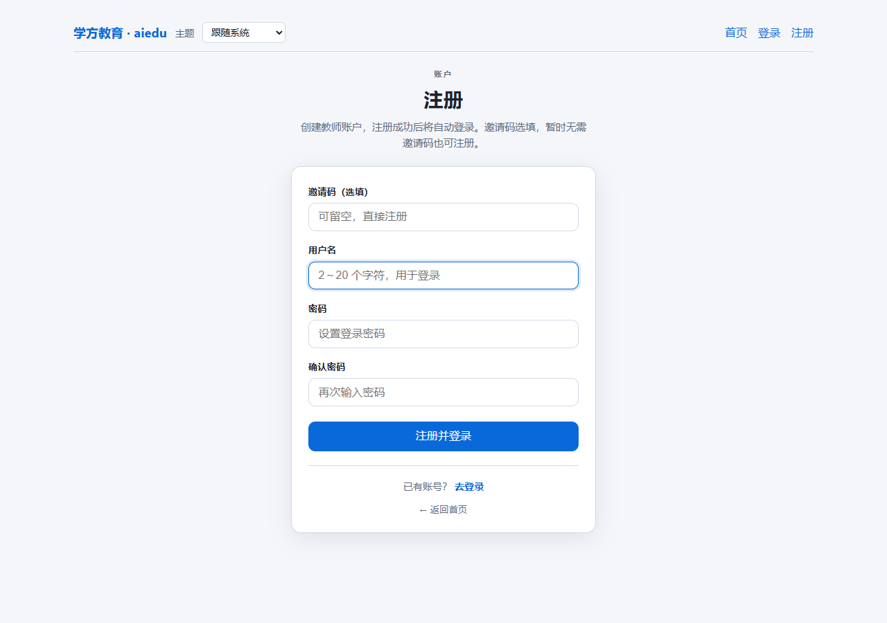
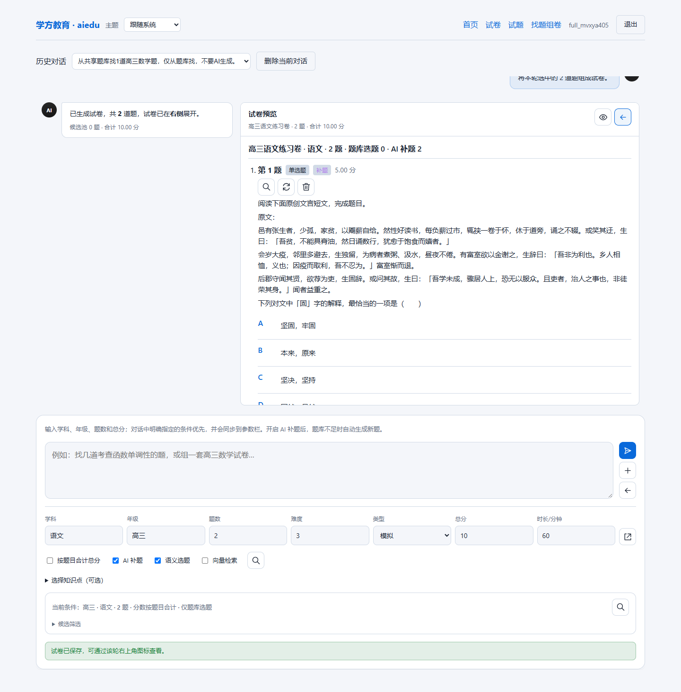
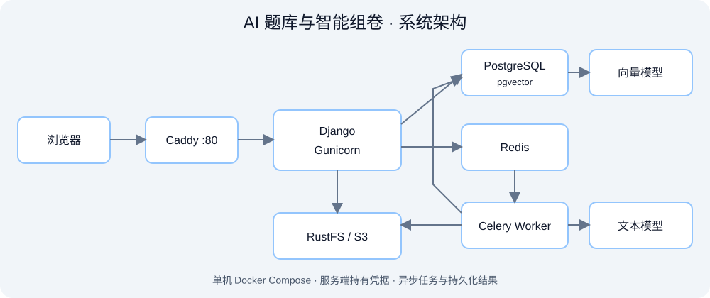

# 学方教育 · AI 题库与智能组卷

**从题库找题，到 AI 补题、选题组卷和保存试卷的一条完整业务链路。**

这是实际部署项目的公开展示仓库，面向技术面试与代码评估，包含架构、接口设计、真实界面和部分核心实现。完整产品源码与运行数据保留在私有项目中。

[在线体验](http://47.83.144.92/) · [直接注册](http://47.83.144.92/accounts/register/) · [架构设计](docs/architecture.md) · [代码导读](code-excerpts/README.md) · [验收与局限](docs/validation.md)

## 两分钟体验

1. 打开在线站点，注册普通账号；邀请码可留空，注册后自动登录。
2. 进入“找题组卷”，输入“从题库找一道数学题”体验共享题库检索。
3. 勾选“AI 补题”，输入“语文2道选择题”，查看生成进度、选项、答案和解析。
4. 将题目加入试卷，点击“用选中题目组卷”，预览、保存并再次打开。

体验账号采用自主注册方式，不公开管理账号或共用密码。当前入口使用 **HTTP**，请使用上面的链接；这是个人维护的体验服务，维护或停机期间可能不可用。请勿提交隐私材料，也不要复用常用密码。

## 真实界面

### 注册与登录



### AI 补题、选题组卷与保存



截图来自实际产品，组卷截图中的用户名为已清理的自动化测试账号；不是可登录的体验账号。界面会随版本迭代。

## 项目解决的问题

| 场景 | 已实现的处理 |
| --- | --- |
| 试卷与试题分散 | 试卷上传、识别处理、题目管理与检索工作流 |
| 自然语言找题 | 将学科、年级、题量等需求转换为结构化请求 |
| 题库数量不足 | 在允许时调用 AI 补题，区分题库题与生成题 |
| 模型返回结构不稳定 | 统一顶层/嵌套选项、字符串/字典选项和答案数组 |
| 阅读题材料重复或丢失 | 保存共享材料、生成材料组标识、避免重复拼接 |
| 长任务与失败反馈 | Celery 异步执行、持久化进度、失败提示与重试 |
| 生成后还需整理 | 选题、预览、调整、保存试卷与再次打开 |

## 工程设计亮点

- **业务约束进入公共流程**：模型输出先规范化，再校验必要字段；缺失选项或引用不存在配图时拒绝接收，避免只靠提示词。
- **批量生成与局部修复**：多题批量处理，保留已通过校验的题目，仅补齐缺额；取消固定等待，向用户反馈阶段进度。
- **异步任务可恢复**：对话与任务结果持久化，提交返回 202，前端轮询结果；请求标识用于对话内去重。
- **鉴权与 CSRF**：会话关联当前用户；保持 CSRF Cookie 的 HttpOnly 设置，由页面隐藏字段提供提交令牌。
- **模型与业务解耦**：文本与向量服务使用硅基流动，按任务配置模型、超时及有限的备用切换；凭据仅由服务端持有。
- **真实部署**：Docker Compose 单机部署，Web、Worker、数据库、缓存、对象存储与反向代理分工运行。

## 技术架构



| 层次 | 技术与职责 |
| --- | --- |
| Web | Django、模板与 JavaScript，账号、题库、组卷交互 |
| 异步执行 | Celery + Redis，生成任务与阶段进度 |
| 业务存储 | PostgreSQL + pgvector，业务记录与向量能力 |
| 文件存储 | RustFS / S3 兼容对象存储，试卷及媒体 |
| AI 服务 | 硅基流动文本模型与向量模型 |
| 部署 | Ubuntu、Docker Compose、Gunicorn、Caddy |

完整流程见 [架构设计](docs/architecture.md)，代表性端点见 [接口设计](docs/api-design.md)。

## 可阅读、可验证的代码

公开的是经过审核的核心片段，而非完整应用：

- [题目结构规范化](code-excerpts/question-schema/generated_question_schema.py)：摘自实际项目，保留可独立运行的实现。
- [对应单元测试](code-excerpts/tests/test_question_schema.py)：覆盖选项兼容、共享材料与无内容补造等边界。
- [对话任务提交片段](code-excerpts/task-workflow/conversation_submission.py)：展示所有权约束、事务去重与异步派发，依赖私有模型，不可单独运行。

无需安装第三方依赖，即可验证公开的结构处理模块：

```bash
python -m unittest discover -s code-excerpts/tests -v
```

测试通过仅证明这些结构处理行为；不证明模型生成的知识或数学结论正确。

## 验收记录与边界

2026-11-01 版本记录了 55 项内部回归测试，以及九门学科、16 个真实模型场景的生成 → 选题 → 保存 → 再次打开流程验收。该批样本生成阶段耗时中位数约 11.5 秒，范围约 5.4–32.0 秒，包含提交与轮询，不能视为延迟承诺。

**流程跑通不等于题目内容正确。** 复核发现部分数学样本的答案与解析存在矛盾；内容一致性仍需继续完善，生成题应经人工审核。上传/OCR 不包含在上述 16 项文本组卷验收范围中。[查看完整验收口径](docs/validation.md)

## 仓库导航

```text
README.md
LICENSE
docs/                    架构、功能、接口、工程取舍与验收
assets/                  实际截图与架构图
code-excerpts/           经审核的部分核心实现与独立测试
scripts/                 公开目录自检脚本
.github/workflows/       公开代码测试与发布内容检查
```

## 公开范围与授权

不提供完整业务源码、生产部署文件、题库原件、数据库备份、管理账号或 API 凭据。本仓库不能一键启动完整网站，完整功能请使用在线体验入口。

代码与文档公开供查看和评估，不采用 MIT / Apache 等开源许可。授权范围见 [LICENSE](LICENSE)。公开仓库仍可被浏览、下载或 Fork；授权声明不构成技术防复制措施。所用第三方软件与服务的权利归各自权利人所有。

维护者：[gituser-x](https://github.com/gituser-x) · 项目沟通：[GitHub Issues](https://github.com/gituser-x/aiedu/issues)
