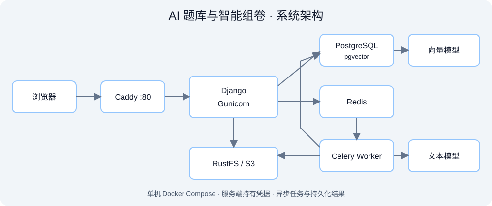
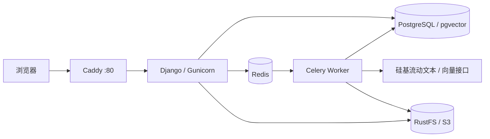
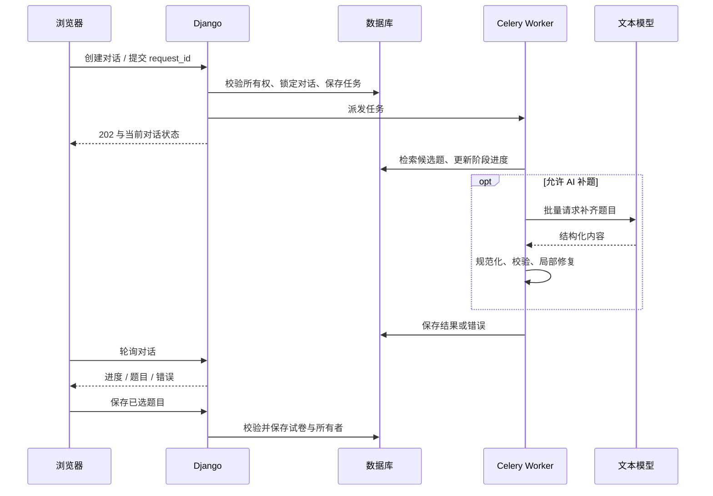

# 系统架构与主链路

浏览器通过 Django Session 认证；对话按用户查询。任务提交后先持久化，再派发至 Worker，前端查询持久化状态和结果，避免长生成请求持续占用 Web 连接。数据库、Redis 与对象存储服务部署于容器网络内。

## 找题与组卷

## 取舍与待完善点

单机 Compose 适合当前低并发展示，部署成本低；它不提供多机高可用。当前公网入口为 HTTP，后续可绑定域名并启用 HTTPS。

数据库事务与队列派发之间仍有故障窗口；当前派发异常会标记任务失败，进一步增强可采用事务发件箱与补偿任务。备用模型和有限重试可以缓解瞬时故障，不能消除供应商不可用。

结构校验解决格式与必要字段问题，无法独立证明知识正确性。答案与解析一致性、数学复算、内容审核是后续重点。
